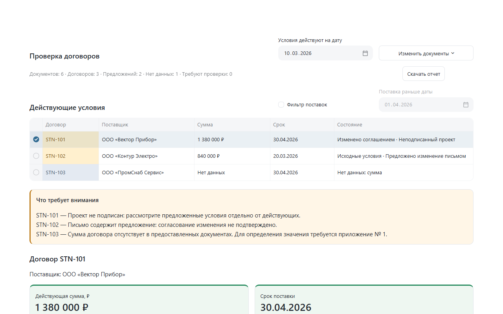

# Semantic Contract Review

**Прототип для проверки условий договоров поставки**

Специалисту по закупкам часто приходится сверять договор, дополнительные соглашения и переписку с поставщиком, чтобы понять, какая сумма и какой срок поставки действуют на нужную дату.

Semantic Contract Review помогает сделать это быстрее. Достаточно загрузить документы и выбрать дату проверки. Приложение покажет действующие условия, учтёт подписанные изменения и отдельно выделит предложения, которые ещё не согласованы.

**Каждый ответ можно проверить по оригиналу:** открыть нужный файл, увидеть точную цитату и её место в тексте. Если сведений недостаточно или документы противоречат друг другу, приложение сообщит об этом вместо того, чтобы угадывать.

Проект создан в рамках тестового задания на позицию Product Owner Semantic TextNavigator.



**[Открыть онлайн-демо в Streamlit](https://semantic-contract-review-ym8fcwqhyfjdv9awt54bgr.streamlit.app/)** — приложение работает в браузере без установки. Нажмите «Открыть пример», чтобы проверить шесть учебных документов. В публичную версию не загружайте конфиденциальные файлы.

## Как попробовать

### Запуск в Windows

Понадобится установленный Python 3.11 и интернет для первой установки зависимостей.

1. Скачайте и распакуйте проект.
2. Дважды нажмите `Start Demo.cmd`.
3. Дождитесь открытия приложения в браузере.
4. Нажмите **«Открыть пример»**, чтобы проверить шесть учебных документов.

При первом запуске приложение самостоятельно подготовит окружение. В дальнейшем зависимости не требуется переустанавливать. Чтобы остановить локальный сервер, нажмите `Ctrl+C` в окне запуска.

Приложение не требует платных API, ключей доступа или подключения к языковой модели.

### Запуск через терминал

Из корня проекта в Windows PowerShell:

```powershell
python -m venv .venv
.\.venv\Scripts\python.exe -m pip install -r requirements.txt
.\.venv\Scripts\python.exe -m streamlit run app.py --server.address 127.0.0.1
```

На Linux и macOS используйте `python3 -m venv .venv` и `.venv/bin/python` вместо Windows-пути. Основные проверки локального запуска выполнялись на Windows.

Приложение использует Python, Streamlit, Pandas и Jinja2. Зависимости описаны в `pyproject.toml` и `requirements.txt`.

## Что можно проверить

В комплекте примеров находятся три договора, подписанное дополнительное соглашение, письмо поставщика и неподписанный проект изменений.

Откройте пример и установите дату **10 марта 2026 года**.

| Вопрос из задания | Ответ |
|---|---|
| Какой срок поставки действует по договору STN-101 на 10 марта 2026 года? | **30.04.2026.** Срок установлен подписанным дополнительным соглашением. Более поздний неподписанный проект не применяется. |
| Какова сумма договора STN-102? | **840 000 ₽.** Аванс 252 000 ₽ не принимается за общую стоимость договора. |
| Какова сумма договора STN-103? | **Нет данных.** Стоимость должна быть указана в спецификации, которой нет в загруженном комплекте. Бюджетный лимит не является ценой договора. |
| По каким договорам поставка запланирована раньше 1 апреля 2026 года и есть ли несогласованные изменения срока? | **STN-102**, срок 20.03.2026. Поставщик предложил перенос на 27.03.2026, но согласованного изменения нет. |

Чтобы проверить ответ, выберите договор в таблице и нажмите **«Проверить в документе»** рядом с суммой или сроком.

Для четвёртого вопроса откройте **«Фильтр поставок»** и укажите дату 01.04.2026.

Можно загрузить и собственные TXT-файлы похожего формата. Приложение обрабатывает их содержимое, а не ищет заранее подготовленные ответы.

Кнопка **«Скачать отчет»** создаёт HTML-файл со сводкой по всему загруженному комплекту, изменениями и подтверждающими источниками. Его можно открыть в браузере без установленного приложения.

## Продуктово-техническая записка

### Для кого и зачем

Основной пользователь — специалист по закупкам, которому нужно быстро установить действующие условия договора и убедиться, что они подтверждены документами.

Главная ценность продукта — меньше времени на ручной поиск и меньше риск пропустить изменение или принять неподписанное предложение за действующее условие. Реальный эффект по времени и качеству предстоит измерить на пилоте.

### Пять вопросов перед развитием продукта

1. **С какими документами работают сотрудники?** Какие встречаются форматы, языки и шаблоны? Насколько часто приходится разбирать сканы, таблицы и плохо читаемые файлы?
2. **Каков реальный объём работы?** Сколько договоров проверяют за день, как часто меняются условия и сколько времени занимает одна проверка?
3. **Как устроено согласование изменений?** Что считается достаточным подтверждением, как устанавливают дату вступления в силу и кто решает спорные случаи?
4. **Где находятся документы?** В какой СЭД или ECM-системе хранятся договоры, версии, приложения и переписка? Какие интеграции доступны?
5. **Какие требования к безопасности?** Кто может просматривать документы, какие действия необходимо фиксировать и кому передавать результаты, требующие ручной проверки?

### Принятые допущения

Для этого задания используется упрощённое правило: условия договора изменяет только дополнительное соглашение, подписанное обеими сторонами и вступившее в силу к выбранной дате. Если известна дата подписания, она также учитывается.

Письма и неподписанные проекты не меняют действующие условия. Они показываются отдельно как предложения или сведения для проверки.

Прототип рассчитан на русскоязычные TXT-документы формата, близкого к учебным примерам: суммы в рублях и календарные даты. Подлинность подписей не проверяется — приложение опирается на сведения внутри текста.

Это инструмент предварительной сверки, а не юридическое заключение.

### Как измерить полезность

**1. Качество определения условий.** На контрольной выборке эксперт независимо определяет сумму, срок, их статус и подтверждающие цитаты. Результат считается правильным, только если совпадают все эти элементы. Отдельно считаются ложные подтверждения и случаи, отправленные на ручную проверку.

**2. Время проверки договора.** Сравниваем медианное время ручной проверки и проверки с приложением на сопоставимых комплектах. Учитываем не только получение ответа, но и изучение источников, исправление ошибок и разрешение спорных случаев.

Фактические значения обеих метрик ещё не измерялись.

### Как устроено решение

```text
TXT-документы
      ↓
Разбор текста и извлечение фактов
      ↓
Проверка изменений и их применимости
      ↓
Действующие условия, история и источники
      ↓
Интерфейс и скачиваемый отчёт
```

Приложение сначала собирает сведения из документов, а затем отдельно решает, какие из них действуют на выбранную дату. Исходные тексты и цитаты сохраняются. Порядок загрузки и названия файлов не определяют приоритет изменений.

**Три основных технических решения:**

1. **Правила вместо обязательной LLM.** Результаты воспроизводимы, а приложение работает без платного API. Компромисс — ограниченный набор поддерживаемых формулировок.
2. **Извлечение отдельно от применения изменений.** Можно сохранять всю историю и пересчитывать условия на другую дату без повторного разбора текста. Компромисс — необходимость явно описывать правила применимости.
3. **Проверяемые цитаты вместо ответов без оснований.** Каждое подтверждённое значение связано с конкретным местом в оригинале. При неопределённости система запрашивает проверку. Это уменьшает риск ложной уверенности, но не исключает ручной работы.

### Что изменится при 100 000 документов

Для такого масштаба понадобится другая инфраструктура: хранение оригиналов и версий, очередь фоновой обработки, база извлечённых фактов, индексы и мониторинг.

Права доступа необходимо учитывать до поиска и выдачи результатов. Для корпоративного использования также потребуются журнал действий, разграничение доступа между пользователями и организациями, управление сроками хранения данных.

Полнотекстовый или гибридный поиск, а также LLM для нестандартных документов стоит рассматривать после проверки качества, стоимости и требований безопасности.

Текущий прототип на такой масштаб не рассчитан. Отдельно проверялась обработка синтетических комплектов до 1 000 документов без интерфейса, но испытаний на 100 000 документов не было.

### Три следующих улучшения

1. **Полноценная ручная проверка спорных случаев.** Возможность подтвердить или исправить извлечённое условие с сохранением решения специалиста. Это позволит измерять качество на реальных данных.
2. **Интеграция с корпоративной системой документов.** Автоматическое получение полных комплектов и версий, права доступа и аудит вместо ручной загрузки файлов.
3. **Поддержка PDF, DOCX и сканов.** Расширение охвата документов при сохранении проверяемых ссылок на исходные фрагменты.

## Как использовался Codex

Прототип разрабатывался с помощью Codex. Работа шла небольшими этапами: сначала извлечение данных, затем применение изменений, интерфейс и тестирование сложных случаев.

Примеры реальных требований, переданных Codex:

> Не хардкодить конкретные номера договоров, названия файлов, даты и суммы в логике приложения.

> Проверяй, что текст evidence действительно содержится в указанном исходном абзаце и соответствует сохраненной позиции.

> Не изменяй ожидаемые результаты ради прохождения тестов. Сохрани все шесть падающих сценариев активными.

Один из показательных дефектов обнаружился при проверке нестандартных формулировок. Если подписанное соглашение меняло срок необычной фразой, приложение могло не распознать изменение и продолжить показывать старую дату как подтверждённую.

После проверки был добавлен механизм обнаружения признаков изменения. Теперь, если факт изменения обнаружен, но новое значение нельзя надёжно определить, соответствующее поле получает статус **«Требуется проверка»**.

Исправление проверено регрессионными сценариями `unknown-dispatch`, `unknown-completion` и `price-increment`. Соответствующие тесты находятся в [test_critical_regression.py](tests/test_critical_regression.py).

Требования, бизнес-правила, приоритеты и критерии приёмки определялись человеком. Codex помогал реализовывать решения и выполнять проверки. Ошибки разбирались по воспроизводимым сценариям, а не исправлялись изменением ожидаемых ответов.

## Проверки и ограничения

По последнему полному прогону: **539 тестов пройдено, 0 ошибок**. После сверки с оригиналом задания отдельно выполнены ещё шесть приёмочных проверок.

Также проверялись запуск в Windows, загрузка и изменение документов, конфликтующие условия, работа с источниками, кодировки и формирование HTML-отчёта.

Для повторного запуска тестов в Windows:

```powershell
.\.venv\Scripts\python.exe -m pip install -r requirements-dev.txt
.\.venv\Scripts\python.exe -m pytest -q
.\.venv\Scripts\python.exe -m pip check
```

Подробнее о проверках — в [QA-отчёте](qa/release/REPORT.md). Соответствие пунктам исходного задания приведено в [матрице требований](docs/requirements.md).

**Что пока ограничивает применение:**

- Нестандартные юридические формулировки могут потребовать ручной проверки. Сложные формулы цены и относительные сроки не вычисляются универсально.
- Подлинность подписей не проверяется.
- Поддерживаются TXT, но не PDF, DOCX и сканы.
- Для некоторых кодировок может понадобиться ручной выбор.
- Ошибка одного файла блокирует формирование сводки, чтобы результат не выглядел полной проверкой неполного комплекта.
- Нет постоянного хранилища, учётных записей и разграничения доступа. Нужный отчёт необходимо скачать до завершения сессии.

Лимиты загрузки: до 200 файлов, не более 2 МиБ на файл и 20 МиБ на комплект.

**В публичное демо загружайте только учебные документы без конфиденциальной информации.**

## Затраченное время

По оценке автора, выполнение задания заняло **около 3 часов активной работы**. Точный хронометраж не вёлся.

Работа включала создание первоначального прототипа, улучшение интерфейса и проверку сложных сценариев. Сверх минимальных требований добавлены автоматическое определение кодировок, запуск в один клик, HTML-экспорт и расширенные регрессионные проверки.

Подробности подготовки проекта к публикации находятся в [инструкции релиза](docs/release.md).